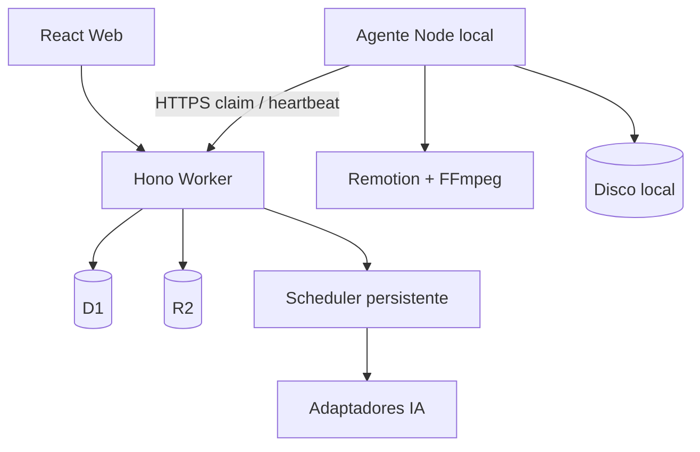

# Arquitectura técnica

## Componentes y límites
Web React/Vite TS + Tailwind/shadcn: UI, cliente REST tipado, sesión via API, previews; ningún acceso directo a storage privado o secretos. API Hono en Cloudflare Workers: autorización, reglas, D1, R2, estado de trabajos, scheduler. Los Workers realizan tareas breves de coordinación e invocaciones compatibles, no FFmpeg/Remotion ni ejecuciones largas bloqueantes. Node local: runner de jobs, caché/archivos, generación compatible, FFprobe/FFmpeg, composición Remotion, publicación opcional de outputs en R2. Adaptadores como frontera de proveedor. Agentes IA generan JSON validable, nunca ejecutan código arbitrario.



## Monorepo objetivo
```
apps/web/          # páginas, componentes, cliente API
apps/api/          # Hono, auth, rutas, repositorios D1, scheduler
apps/local-agent/  # CLI, conexión, claim, servicios multimedia
packages/contracts/# Zod/DTO/enums compartidos, sin SDK servidor
packages/domain/   # reglas puras, DAG, invalidación, presupuestos
packages/providers/# interfaces, mocks, adaptadores concretos
packages/render/   # composición Remotion, manifest, presets
packages/testkit/  # fixtures y builders reproducibles
infra/             # wrangler config, migraciones SQL, scripts
docs/              # especificaciones, ADR y STATUS
```
Dependencias: web → contracts; API → contracts/domain/providers; agente → contracts/domain/providers/render; render → contracts. Domain no depende de UI, DB ni red. Boundaries browser/node/worker explícitos; no importar módulos Node en Worker. Versiones pinneadas via lockfile, engines y packageManager después de verificar compatibilidad; pnpm workspace sin Nx/Turborepo inicialmente. Scripts raíz: dev, dev:web, dev:api, dev:agent, lint, typecheck, test, test:e2e, build, db:migrate:local.

## Entornos
Local: API + D1/R2 emulados, web Vite, agente en máquina de pruebas, fake providers. Staging: recursos separados, presupuesto desactivado o muy bajo y datos ficticios. Producción: recursos aislados, secretos runtime, acceso propietario, despliegue manual autorizado; estáticos y API preferentemente mismo origen. Config validar al startup y fallar con mensaje, nunca fallback a producción. `.env.example` solo nombres: APP_ORIGIN, AUTH_SECRET, AGENT_API_URL, AGENT_TOKEN, LOCAL_MEDIA_ROOT, PROVIDER_*; bindings D1/R2 en conf por entorno. Separar credenciales local/cloud. Agente acepta root configurable y paths Windows absolutos.

## Persistencia y ejecución
Propuesta base: D1 almacena estado y cola; disparador periódico y/o llamadas explícitas avanzan un lote pequeño; jobs locales se reclaman via API. No ejecutar cron con esperas largas. External jobs async se consultan por ID y próxima fecha; reconciliar resultados. Si limits reales no permiten esto, presentar ADR antes de agregar colas/workflows de pago. Transiciones con actualización condicional atómica, lease por job, token de fencing y optimistic revision; dependencias explícitas. Efectos externos fuera de transacción, idempotency keys y reconciliación. Datos consistentes incluso si el Worker expira.

## Almacenamiento
Clave R2 privada `users/{uid}/projects/{pid}/assets/{assetId}/{checksum}.{ext}`; no usar nombre ingresado ni ruta del cliente. D1 es catálogo. Disco local cache `root/projects/{pid}/assets/{assetId}` con permisos locales; verificar hash, tamaño, tipo y disponibilidad. Temp por job/intento; escribir parcial, verificar y renombrar atómicamente. Subidas por mecanismo autorizado, tamaño limitado, checksum comprobado y finalización API; limpieza solo de temporales propios y objetos huérfanos con retención. No guardar video pesado en git ni D1. R2 solo copias autorizadas por configuración; UI indica LOCAL_ONLY/REMOTE_AVAILABLE/MISSING. Backup de DB + manifests y media final; verificar restauración antes de producción.

## Observabilidad MC
Logs estructurados {requestId, projectId, jobId, attempt, provider, event, durationMs, code}; no datos sensibles ni prompts completos en logs. Activity ledger para cambios, aprobación y costos. Métricas de queue latency, success/failure, retries, lease expiring, provider spend, render speed y disponibilidad agente. Sin servicios de observabilidad pagos obligatorios.
